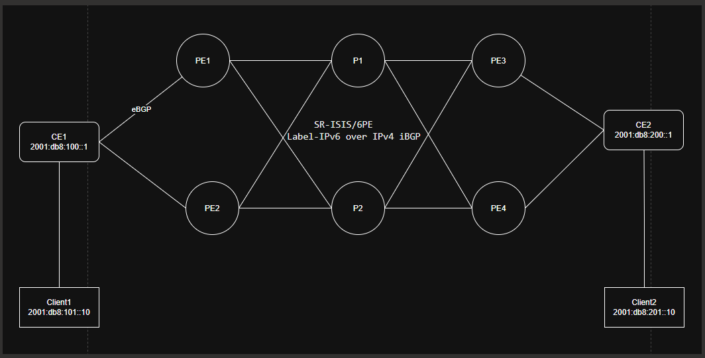

# SR OS 25.7.R1 | 10-Node Dual-Homed 6PE BGP-ECMP Lab

## Physical topology




## IP addressing and routing

| Endpoint | Role/IP | ASN |
|---|---|---|
| PE1 / PE2 / PE3 / PE4 | System IPv4 `192.0.2.1–4/32`; Node-SID index 1–4 | 64496 |
| P1 / P2 | System IPv4 `192.0.2.11/32`, `192.0.2.12/32`; Node-SID index 11/12 | Not a BGP speaker |
| CE1 | 2001:db8:100::1/48 loopback; 2001:db8:101::1/64 gateway | 64501 |
| CE2 | 2001:db8:200::1/48 loopback; 2001:db8:201::1/64 gateway | 64502 |
| Client1 | 2001:db8:101::10/64, VLAN 101, GW ::1 | Linux |
| Client2 | 2001:db8:201::10/64, VLAN 201, GW ::1 | Linux |

CE-to-PE adjacencies: CE1–PE1 `2001:db8:10::1/126 ↔ ::2`, CE1–PE2 `2001:db8:110::1/126 ↔ ::2`, CE2–PE3 `2001:db8:210::2/126 ↔ ::1`, CE2–PE4 `2001:db8:20::2/126 ↔ ::1`.

## Route architecture

1. CE1 advertises `2001:db8:100::/48` and `2001:db8:101::/64` via **both** eBGP sessions, to PE1 and PE2.
2. CE2 advertises `2001:db8:200::/48` and `2001:db8:201::/64` via **both** eBGP sessions, to PE3 and PE4.
3. Four PE system IPv4 loopbacks form **six full-mesh labeled-IPv6 iBGP sessions**, AFI 2/SAFI 4 only.
4. Each PE has a separate `6PE-TO-IPV6` route-table-import policy for its **remote CE** prefixes, and a `CE-OUT` export policy sending those prefixes to its locally attached CE.
5. Equal default IS-IS link metrics, no P–P link, and symmetrical physical connections make both remote PE loopbacks reachable at **equal IGP cost**. All P/PE routers advertise distinct system IPv4 Node-SIDs for SR-MPLS transport. Each PE has `ecmp 2` and `bgp multipath family label-ipv6 ibgp 2`.
6. CE1/CE2 permit IPv6 eBGP multipath of two and Base router ECMP of two, enabling CE-level sharing when BGP sees both external paths as equivalent.

## Deploy 

```bash
Get license file from Nokia Rep and cp in this folder.
containerlab deploy -t ipv6-dualh.yaml
containerlab inspect -t ipv6-dualh.yaml
```

## Validate

**Check IS-IS underlay first:** Every PE has two IS-IS adjacencies; P1/P2 each has four. Verify all six PE–P loopback tunnels resolve:

```text
show router isis adjacency
show router route-table 192.0.2.3/32 extensive
show router route-table 192.0.2.4/32 extensive
```

**Check on PE1 and PE2:**

```text
PE1:
info flat configure router "Base" bgp rib-management
info flat configure router "Base" bgp multipath
info flat configure router "Base" ecmp
show router isis adjacency
show router bgp summary
show router bgp routes 2001:db8:201::/64 label-ipv6
show router bgp routes 2001:db8:201::/64 label-ipv6 detail
show router bgp routes 2001:db8:201::/64 ipv6 all
show router route-table 2001:db8:201::/64 extensive
show router fib 1 2001:db8:201::/64 extensive
show router bgp routes 2001:db8:200::/48 label-ipv6
show router bgp neighbor "2001:db8:10::1" advertised-routes ipv6
show router fp-tunnel-table 1 192.0.2.3/32

PE2:
info flat configure router "Base" bgp rib-management
info flat configure router "Base" bgp multipath
info flat configure router "Base" ecmp
show router isis adjacency
show router bgp summary
show router bgp routes 2001:db8:201::/64 label-ipv6
show router bgp routes 2001:db8:201::/64 label-ipv6 detail
show router bgp routes 2001:db8:201::/64 ipv6 all
show router route-table 2001:db8:201::/64 extensive
show router fib 1 2001:db8:201::/64 extensive
show router bgp routes 2001:db8:200::/48 label-ipv6
show router bgp neighbor "2001:db8:110::1" advertised-routes ipv6
show router fp-tunnel-table 1 192.0.2.3/32

```

**Check on P1 and P2:**

```text
show router isis adjacency
show router route-table
show router tunnel-table
show router interface
```

**Check on CE1 and CE2:**

```text
#CE1
show router bgp summary
show router bgp routes ipv6
show router route-table 2001:db8:201::/64 extensive
show router route-table ipv6
show router interface

#CE2 
show router bgp summary
show router bgp routes ipv6
show router route-table 2001:db8:101::/64 extensive
show router route-table ipv6
show router interface

```

**Check BGP:** Each PE should establish three IPv4-loopback labeled-IPv6 iBGP neighbors plus its one IPv6 eBGP CE neighbor; each CE establishes two IPv6 eBGP sessions. 
Use `show router bgp summary` and `checks/*.cli`.

**Critical ECMP test on PE1 and PE2:**

```text
show router bgp routes 2001:db8:201::/64 label-ipv6
show router bgp routes 2001:db8:201::/64 label-ipv6 detail
show router bgp routes 2001:db8:201::/64 ipv6 all
show router route-table 2001:db8:201::/64 extensive
show router fib 1 2001:db8:201::/64 extensive
```

**Reverse ECMP test on PE3 and PE4:**

```text
show router bgp routes 2001:db8:101::/64 label-ipv6
show router route-table 2001:db8:101::/64 extensive
show router fib 1 2001:db8:101::/64 extensive
```

**Client-to-client reachability and traffic:**

```bash

client1:~$ ping 2001:db8:201::10

client2:~$ ping 2001:db8:101::10

```

Collect before/after egress-byte deltas on the PE–P ports (on every PE, `1/1/c2/1` towards P1 and `1/1/c3/1` towards P2):

```text
show port 1/1/c2/1 statistics
show port 1/1/c3/1 statistics
```


